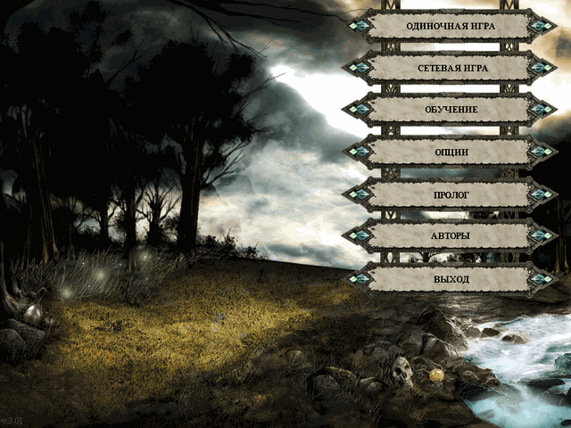
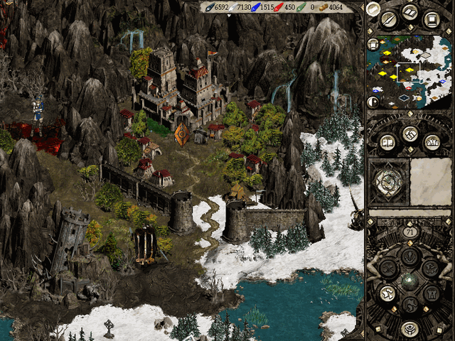
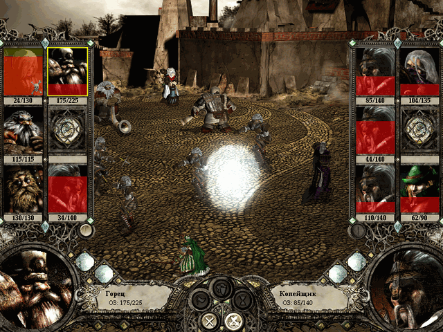
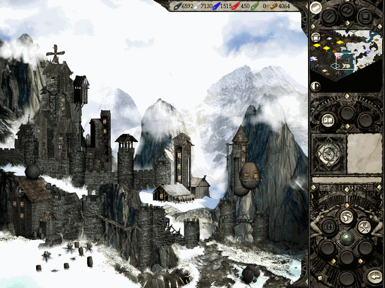
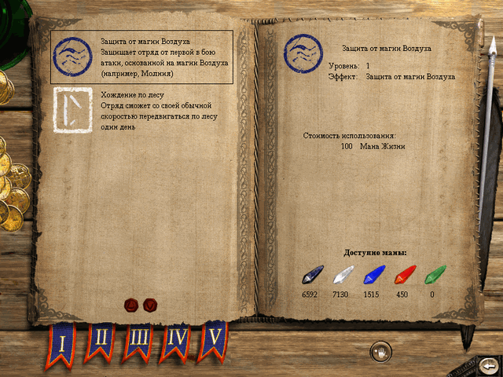

# Disciples II for Godot

A fan reimplementation of **Disciples II: Rise of the Elves** (GOG 3.01) on **Godot 4.7**, with the game rules in **C# / .NET 10**.
The goal is a port that *behaves exactly like the original* — battle formulas, AI decisions, turn order, economy — while being
organised like a modern game: data separate from code, mod layers, extension points, plain image and sound formats that can be
replaced with high-resolution versions.

**This repository contains no game data.** You need your own purchased copy of Disciples II (GOG); the port imports its art,
sound, videos and tables from it on first start.

[](docs/screenshots/main-menu.png)
[](docs/screenshots/world-map.png)
[](docs/screenshots/battle.png)
[](docs/screenshots/city.png)
[](docs/screenshots/spellbook.png)

## Status

Single-player campaigns, quests and hot-seat play: main menu, scenario and campaign selection, world map, cities, battles,
spells, items, diplomacy, saves, videos and music.

Fidelity is proven by code, not by eye. A probe DLL loaded into the original game (`tools/d2probe`) records journals of real play —
battles, AI turns, random-number draws, UI events — and test harnesses replay the same situations in the port and compare the
results decision by decision (`docs/principles.md`, `docs/corpus-schema.md`). The divergence register
(`docs/divergence-ledger.md`) lists **378 differences found, 0 open**. Network multiplayer of the original is not ported.

## Requirements

- **Disciples II: Rise of the Elves, GOG version 3.01** (English). A Russian localization can be layered on top (see below).
- Windows 10/11 x64 for the release build. Building from source works wherever Godot 4.7 .NET and the .NET 10 SDK run.
- Optional: [ffmpeg](https://ffmpeg.org) to import the game's Bink videos — without it the port runs without videos. Put
  `ffmpeg.exe` and `ffprobe.exe` into an `ffmpeg/` folder next to `Disciples.exe` (or on `PATH`) **before** the first start.

## Installation

1. Download `disciples-godot-win64.zip` from the Releases page and unpack it to any folder you can write to.
2. Run `Disciples.exe`. On first start it asks for your **Disciples II folder** (a GOG installation is found automatically),
   optionally a folder with a Russian version of the game, and imports the game data — a few minutes, about 1.3 GB in
   `%APPDATA%\Godot\app_userdata\Disciples\game`.
3. The main menu opens when the import is done. Later starts go straight to the menu.

Command line: `--game-dir <folder>` (import without asking), `--l10n <folder>` (Russian copy of the game: Russian texts, fonts
and scenario translations), `--data-dir <folder>` (where the imported data lives), `--lang en|ru`.

## Building from source

```bash
git clone <this repository> disciples-godot && cd disciples-godot
dotnet build Disciples.sln                                   # .NET 10 SDK (pinned in global.json)
py tools/import_game.py --game "C:/GOG Games/Disciples II"   # game data into data/ and assets/ (runs Godot 4.7.2 mono headless)
dotnet test --filter "Category!=Corpus&Category!=Synth"      # smoke tests; tests that need game data skip without it
godot --path godot                                           # play (Godot 4.7.2 .NET)
```

- `py tools/check.py` — build, affected tests and UI checks in one command (`--full` runs everything).
- `powershell -File tools/publish/build_windows.ps1` — Windows release build into `dist/` (Godot export templates 4.7.2).
- Tests in the `Corpus` and `Synth` categories need probe journals of the original game, which are not in the repository.
- Project rules and architecture: `docs/principles.md`, `docs/godot-architecture.md`, `docs/development.md`, `CLAUDE.md`;
  how the import and the public tree are made: `docs/publishing.md`.

## Modding

A mod is a folder with `mod.json` in `mods/` (next to the game) or in the user folder `user://mods`. It is layered over the base
data by stable identifiers — screens, UI frames, transitions, races and lords, scenarios, map art, videos, fonts, strings — and
never changes the base files. Examples: `mods/_examples`. Format: [docs/modding.md](docs/modding.md).

## License

The code is licensed under the **GNU General Public License v3.0** (`LICENSE`). Third-party parts keep their licenses:
`tools/d2probe` (D2ModdingToolset, GPL-3.0, `tools/d2probe/NOTICE.md`), the `.ff` archive reader derived from
Karnah/Disciples.Net (MIT, `tools/ui-assets/NOTICE`), the EB Garamond font (SIL OFL 1.1, `data/fonts/OFL.txt`); the Godot API
reference in `tools/godot-ref/godot47.jsonl` is extracted from the Godot Engine class reference (© Juan Linietsky, Ariel Manzur and
the Godot community, CC BY 3.0).

## Disclaimer

This is an unofficial, non-commercial fan project, not affiliated with or endorsed by Strategy First, Akella, Kalypso Media or
GOG. "Disciples" and all related names, artwork, music, texts and other game content are trademarks and copyrighted property of
their respective owners. Neither this repository nor the release builds contain original game assets; to play you must own a
legitimate copy of Disciples II. The screenshots in `docs/screenshots` show the port running with data imported from such a copy.

---

## По-русски

Порт **Disciples II: Восстание эльфов** (GOG 3.01) на Godot 4.7 и C#/.NET 10. Поведение — как в оригинале (доказывается
харнессами по журналам зонда оригинала; реестр расхождений — **378 найдено, 0 открыто**), устройство — по современным стандартам:
данные отдельно от кода, слои модов, обычные форматы графики.

**Данных игры нет ни в репозитории, ни в сборке.** Нужна своя купленная копия Disciples II (GOG). При первом запуске
`Disciples.exe` спросит папку игры (установку GOG найдёт сам) и, по желанию, папку русской версии игры — из неё берутся русские
тексты, шрифты с кириллицей и переводы сценариев; затем импортирует данные (несколько минут) и откроет главное меню. Ролики
импортируются, если рядом с `Disciples.exe` (папка `ffmpeg/`) или в `PATH` есть ffmpeg.

Сборка из исходников и импорт для разработчика — «Building from source» выше, `docs/development.md` и `docs/publishing.md`;
правила проекта — `docs/principles.md` и `CLAUDE.md`; моды — `docs/modding.md`. Лицензия — GPL-3.0. Это неофициальный
некоммерческий проект; права на игру и её содержимое принадлежат их владельцам.
